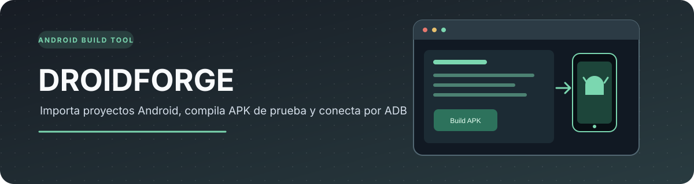
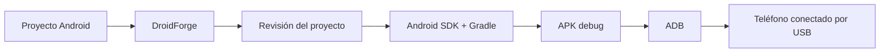

<p align="center">
  
</p>

<p align="center">
  
  
  
  
  
  
</p>

<h1 align="center">DroidForge</h1>
<p align="center">Una herramienta de Windows para preparar y compilar proyectos Android de prueba.</p>

<p align="center">
  <a href="#flujo-de-trabajo">Flujo</a> ·
  <a href="#qué-se-puede-hacer">Funciones</a> ·
  <a href="#preparar-las-herramientas">Herramientas</a> ·
  <a href="#limitaciones">Limitaciones</a>
</p>

DroidForge es una aplicación para Windows que estoy desarrollando para probar una forma más sencilla de compilar proyectos Android e instalar el APK en un teléfono conectado por USB, sin tener que abrir Android Studio.

La aplicación todavía es una primera versión y tiene limitaciones.

## Flujo de trabajo



## Qué se puede hacer

| Función | Descripción |
|---|---|
| Importar | Abrir un proyecto Android Gradle |
| Crear | Generar un proyecto Kotlin básico |
| Preparar | Descargar herramientas Android necesarias |
| Compilar | Generar una versión debug |
| Instalar | Enviar el APK al teléfono por ADB |

## Requisitos

- Windows 10 u 11 de 64 bits.
- Node.js 20 o superior.
- Para compilar: JDK 17, Android SDK Command-line Tools, Platform Tools, Build Tools y Gradle.
- Un teléfono Android con depuración USB activada y autorizado en la computadora.

## Ejecutar en desarrollo

```powershell
npm install
npm run dev
```

## Preparar las herramientas

Desde PowerShell, en la carpeta del proyecto:

```powershell
Set-ExecutionPolicy -Scope Process Bypass
.\scripts\setup-tools.ps1
```

La preparación inicial necesita internet para descargar las herramientas. Revisa el script antes de ejecutarlo y asegúrate de usar las descargas oficiales.

## Limitaciones

- Por ahora genera APK de depuración; no prepara una versión firmada para publicar.
- El generador crea una Activity Kotlin básica, no es un editor completo.
- Los proyectos importados deben ser compatibles con Android Gradle.
- La primera descarga de herramientas puede ocupar bastante espacio.

## Tecnologías

Electron, React, TypeScript, Node.js, Gradle y ADB.

<p align="center"><sub>Prototipo para Windows · No sustituye Android Studio ni es un editor Android completo.</sub></p>
